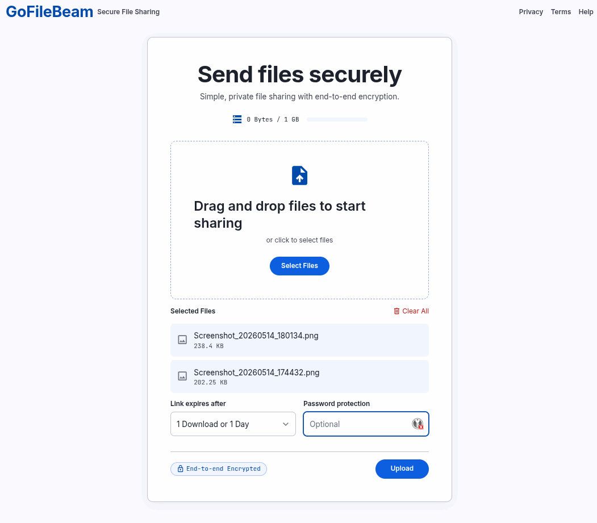

# GoFileBeam

A lightweight, secure file sharing service written in Go. Features end-to-end encryption, expiration policies, and storage quota management.



## Features

- **Secure File Sharing**: Upload files with optional password protection
- **End-to-End Encryption**: Files encrypted with AES-GCM before storage
- **Chunked Uploads**: Large files are automatically split into small sequential requests, so no single HTTP request body needs to exceed reverse-proxy/CDN size limits (e.g. Cloudflare)
- **Expiration Policies**: Files expire after specified downloads or time period
- **Storage Quota**: Configurable storage limit (default: 1GB)
- **Single Binary**: Easy deployment on any platform
- **REST API**: Simple API for integration
- **Web UI**: Built-in web interface for easy file sharing

## Quick Start

### Build

```bash
go build -o gofilebeam ./cmd/gofilebeam
```

### Run

```bash
./gofilebeam
```

The service will start on `http://localhost:8080` (or your configured port).

On startup, you'll see the security status:
```
✓ Sandbox initialized
✓ Rate limiter initialized (60 req/min)
✓ Brute force protection enabled
✓ File validation enabled
✓ Sandbox protection enabled
```

All security features are active by default.

## Configuration

Configure via environment variables:

| Variable | Description | Default |
|----------|-------------|---------|
| `GOFILEBEAM_PORT` | Server port | `8080` |
| `GOFILEBEAM_HOST` | Server host | `0.0.0.0` |
| `GOFILEBEAM_STORAGE_PATH` | Path for file storage | `./uploads` |
| `GOFILEBEAM_MAX_STORAGE_GB` | Maximum storage in GB | `1` |
| `GOFILEBEAM_MAX_FILE_SIZE_MB` | Maximum file size in MB | `100` |
| `GOFILEBEAM_ENABLE_HTTPS` | Enable HTTPS | `false` |
| `GOFILEBEAM_TLS_CERT_PATH` | TLS certificate path | - |
| `GOFILEBEAM_TLS_KEY_PATH` | TLS key path | - |
| `GOFILEBEAM_RATE_LIMIT_PER_MINUTE` | Rate limit per minute | `60` |
| `GOFILEBEAM_CLEANUP_INTERVAL_MINUTES` | Cleanup interval in minutes | `60` |
| `GOFILEBEAM_CHUNK_SIZE_MB` | Size of each chunk in the chunked upload protocol | `8` |
| `GOFILEBEAM_CHUNK_UPLOAD_THRESHOLD_MB` | Files at or above this size use chunked upload instead of a single request | `80` |
| `GOFILEBEAM_CHUNK_SESSION_TIMEOUT_MINUTES` | How long an idle chunked upload session is kept before being discarded | `30` |

Example with custom configuration:

```bash
export GOFILEBEAM_PORT=3000
export GOFILEBEAM_MAX_STORAGE_GB=5
export GOFILEBEAM_STORAGE_PATH=/var/gofilebeam/uploads
./gofilebeam
```

## API Endpoints

### Upload File
```
POST /api/upload
Content-Type: multipart/form-data

Parameters:
- file: The file to upload
- expiration_option: "1 Download or 1 Day", "10 Downloads or 7 Days", or "100 Downloads or 30 Days"
- password: Optional password for encryption
```

This single-request endpoint is simplest, but every reverse proxy or CDN
sitting in front of GoFileBeam enforces its own maximum request body size
that cannot be configured away at the application level. Notably,
**Cloudflare caps request bodies at 100 MB on Free/Pro plans, 200 MB on
Business, and 500 MB on Enterprise** — a file that exceeds your plan's
limit will fail with a `413` or a client-side connection reset partway
through the upload, regardless of `GOFILEBEAM_MAX_FILE_SIZE_MB`. For files
at or above `GOFILEBEAM_CHUNK_UPLOAD_THRESHOLD_MB`, use the chunked upload
protocol below instead; the built-in web UI does this automatically.

### Chunked Upload (for large files)

Splits a file into small sequential requests so no single request body
ever approaches a proxy/CDN size limit, regardless of total file size.

```
# 1. Initialize a session
POST /api/upload/init
Content-Type: application/json
{
  "filename": "movie.mp4",
  "size": 734003200,
  "expiration_option": "10 Downloads or 7 Days",
  "password": "optional"
}
-> { "session_id": "...", "chunk_size": 8388608, "total_chunks": 88 }

# 2. Upload each chunk (raw bytes, repeat for index 0..total_chunks-1)
POST /api/upload/chunk?session_id={session_id}&index={index}
Content-Type: application/octet-stream
<raw chunk bytes, sliced from the file at index * chunk_size>
-> { "received": 1, "bytes_received": 8388608, "total_chunks": 88 }

# 3. Complete the session once all chunks are uploaded
POST /api/upload/complete
Content-Type: application/json
{ "session_id": "..." }
-> same response shape as POST /api/upload

# Optional: abort and free staging disk space early
POST /api/upload/abort
Content-Type: application/json
{ "session_id": "..." }
-> 204 No Content
```

Calling `/complete` before all chunks have arrived returns `400` and is
safe to retry once the remaining chunks are sent — the session is not
destroyed by a premature completion attempt. Sessions left idle longer
than `GOFILEBEAM_CHUNK_SESSION_TIMEOUT_MINUTES` are automatically discarded
and their staged data removed.

> **Known limitation:** the chunked protocol applies to a single file per
> session. Selecting multiple files at once in the web UI still uses the
> single-request `/api/upload` endpoint, which zips them together
> server-side — so a large *combined* multi-file selection can still hit
> the same proxy/CDN body size limit the chunked protocol exists to avoid.
> If you need to share several large files, upload them individually.

### Upload Configuration
```
GET /api/upload/config
-> { "max_file_size": ..., "chunk_size": ..., "chunk_upload_threshold": ..., "chunked_upload_enabled": true }
```

Lets a client determine the current chunk size and threshold without
hardcoding them, so the frontend and any custom API clients stay in sync
with server configuration.

### Download File
```
GET /api/download/{file_id}
GET /api/download/{file_id}?password={password}
```

### Storage Information
```
GET /api/storage
```

### Health Check
```
GET /api/health
```

## Web Interface

Access the web interface at `http://localhost:8080` (or your configured host/port).

The interface allows:
- Drag-and-drop file upload
- Password protection
- Expiration policy selection
- Real-time storage usage display

**Production CSS:** The project includes a pre-built, minified Tailwind CSS file (`static/css/output.css`) optimized for production use. If you need to modify the styles:

```bash
# In the project root directory (/home/ilfs/Public/GoFileBeam)

# Install dependencies (first time only)
npm install

# Rebuild CSS after making changes
npm run build:css

# Or watch for changes during development
npm run watch:css
```

## Security Features

GoFileBeam implements multiple layers of security to protect your files and prevent abuse:

### File Security
- **No File Type Restrictions**: Share any file type (.exe, .sh, .bat, etc.) - security via sandbox, not blocking
- **Filesystem Sandbox**: Files stored with 0444 permissions (read-only, no execute) - cannot run on server
- **AES-256-GCM Encryption**: Password-protected files encrypted with industry-standard encryption
- **Path Traversal Prevention**: All file paths validated to prevent directory escape attacks

### Access Control
- **Rate Limiting**: 60 requests/minute per IP (configurable) with automatic blocking after violations
- **Brute Force Protection**: Blocks IP after 5 failed password attempts for 30 minutes
- **Password Hashing**: Passwords hashed with SHA256 and unique salt per file

### Network Security
- **Security Headers**: XSS protection, frame denial, content-type sniffing prevention
- **HTTPS/TLS Support**: Optional TLS encryption for data in transit
- **CORS Configuration**: Controlled cross-origin access

### Data Management
- **Automatic Expiration**: Files auto-delete after time limit or download count
- **Storage Quota**: Prevents disk exhaustion with configurable limits
- **Real-time Monitoring**: Storage info reflects actual filesystem state

**For detailed information, see:**
- [docs/QUICKSTART.md](docs/QUICKSTART.md) - Quick start guide
- [docs/SECURITY.md](docs/SECURITY.md) - Complete security documentation

## Deployment

### As a System Service (Linux)

Create a systemd service file `/etc/systemd/system/gofilebeam.service`:

```ini
[Unit]
Description=GoFileBeam File Sharing Service
After=network.target

[Service]
Type=simple
User=gofilebeam
Group=gofilebeam
WorkingDirectory=/opt/gofilebeam
Environment="GOFILEBEAM_STORAGE_PATH=/var/gofilebeam/uploads"
Environment="GOFILEBEAM_MAX_STORAGE_GB=10"
ExecStart=/opt/gofilebeam/gofilebeam
Restart=on-failure

[Install]
WantedBy=multi-user.target
```

### Docker

```bash
docker build -t gofilebeam .
docker run -p 8080:8080 -v ./uploads:/uploads gofilebeam
```

## Development

### Prerequisites
- Go 1.19 or later

### Build and Test

```bash
# Build
go build ./cmd/gofilebeam

# Run tests
go test ./...

# Run with race detector
go run -race ./cmd/gofilebeam
```

## Documentation

Additional documentation is available in the [`docs/`](docs/) directory:

- **[QUICKSTART.md](docs/QUICKSTART.md)** - Get started in 5 minutes
- **[SECURITY.md](docs/SECURITY.md)** - Complete security documentation

## License

MIT License